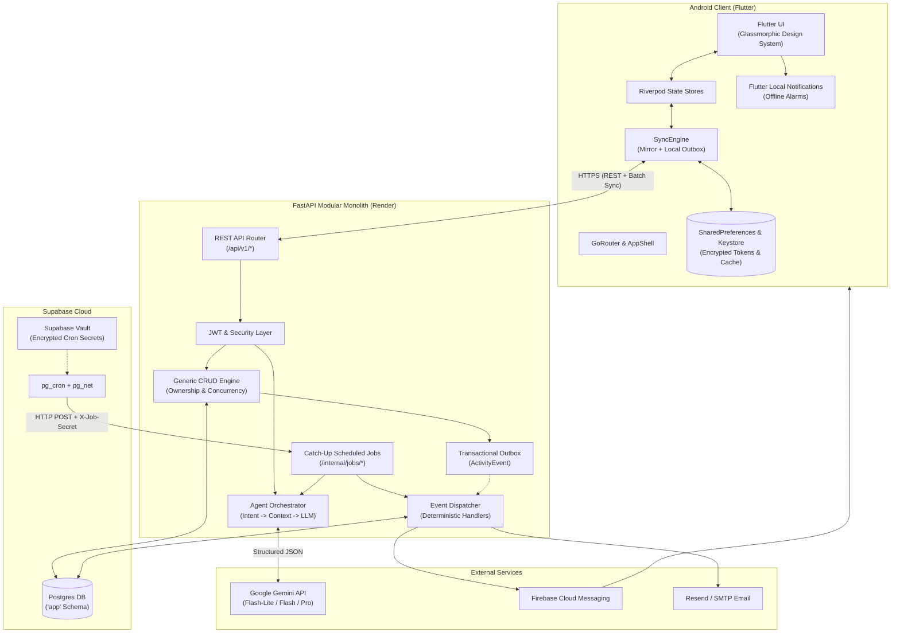
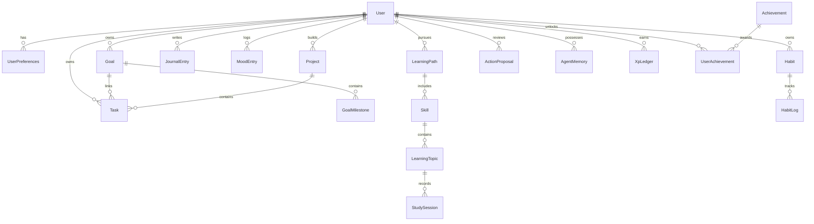
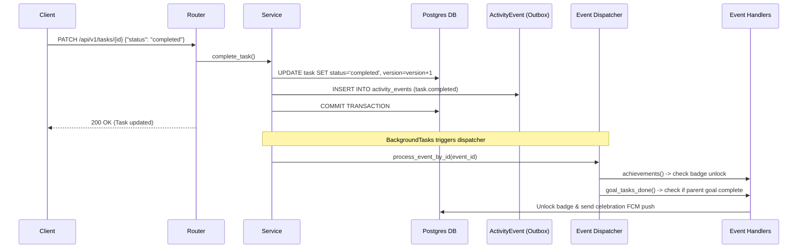
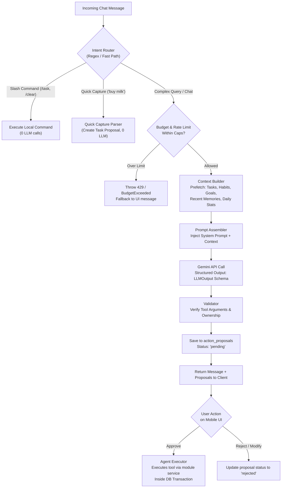
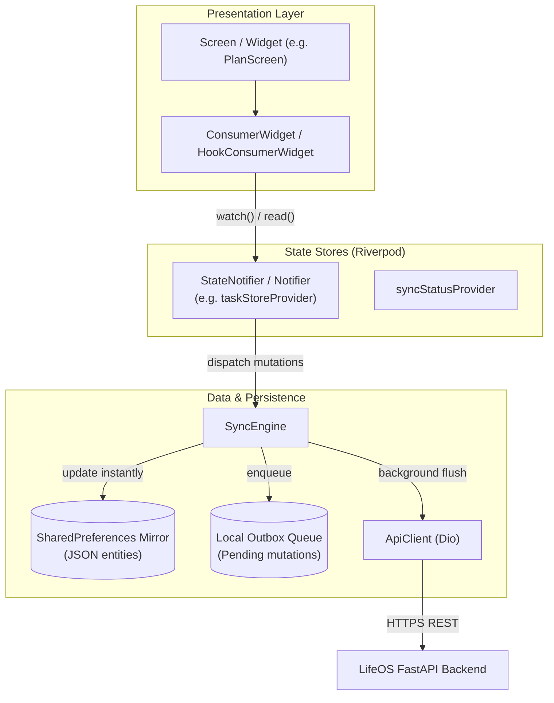

# LifeOS — System Architecture & Complete Codebase Context

> **Target Audience**: Large Language Models (LLMs) and software engineers onboarding or implementing features in LifeOS.  
> **Repository Root**: `c:\College_projects\LifeOS`  
> **Last Updated**: November 2026  
> **Status**: Production-ready Backend & Flutter Android Client

---

## 1. Executive Summary & Design Principles

### 1.1 What is LifeOS?
**LifeOS** is a personal, agentic life-management ecosystem designed to unify personal productivity, learning, reflective journaling, gamification, and social accountability under a **single central AI agent**. It is composed of a **Flutter mobile app (Android)** and a **Python FastAPI modular monolith**, backed by **Supabase Postgres** and Google's **Gemini API**.

LifeOS manages:
- **Tasks & Subtasks**: Recurring tasks (RFC 5545 iCal rules), priority levels, deadlines, tags, project/goal associations.
- **Goals & Milestones**: Multi-step goals with progress tracked manually, by task completion, or by target numbers.
- **Habits & Streaks**: Periodic habits with recurrence rules, daily logs, streak counters, and missed-habit detection.
- **Learning & Projects**: Skill trees, learning roadmaps, topics with study resources, Pomodoro/focus timer sessions with distraction tracking, and project portfolios.
- **Time Blocking & Reminders**: Daily planner schedule blocks, local on-device alarms, and server-side notifications.
- **Reflective Journaling & Mood Tracking**: Rich journal entries with mood scoring (1–5), emotional tags, energy levels, and trend analysis.
- **Progression & Gamification**: XP ledger, user levels calculated via polynomial mathematical curves, and trigger-based achievement badges.
- **Social Accountability**: Friendships, friend groups, group habits, mutual check-ins, and activity feed reactions.
- **Single Central AI Agent**: An assistant that understands full personal context, conducts morning previews and evening/weekly reviews, and **proposes structured actions** for user approval.

---

### 1.2 Core Architectural Principles & Invariants

When writing code or generating responses for LifeOS, **the following invariants must never be broken**:

1. **The App Works Without AI**:
   - Every core function (tasks, habits, journal, calendar, stats) must operate seamlessly if the Gemini API is down, rate-limited, disabled by the user, or over budget.
   - When no Gemini API key is configured, the backend automatically falls back to an offline deterministic mock assistant.

2. **The AI Never Touches the Database Directly**:
   - The AI agent has zero direct write access to the database or SQL layer.
   - The AI reads prefetched, sanitized context and returns **structured action proposals** (`ActionProposal`).
   - The user must explicitly inspect and approve proposals (via UI cards).
   - Upon approval, the backend executes the proposal using the **exact same internal domain service code path** that standard user-initiated HTTP requests invoke.

3. **No AI for Arithmetic or Aggregations**:
   - Streaks, percentages, completion rates, study durations, level curves, and analytics are calculated strictly in deterministic Python or SQL queries.
   - The AI is never prompted to compute mathematical summaries; it only receives pre-computed stats and focuses purely on semantic synthesis, behavioral coaching, and contextual recommendations.

4. **Persistent, Transparent, and User-Controlled Memory**:
   - The agent maintains an episodic memory (log of milestones and completions) and a semantic summary of the user's habits and preferences.
   - All memories are stored in standard Postgres tables (`agent_memory`), visible to the user in the UI, and can be modified or deleted at any time.

5. **Strict Cost Control & $0 Infrastructure Target**:
   - Infrastructure operates entirely on free tiers (Render web service, Supabase free Postgres, Firebase Cloud Messaging, GitHub Actions).
   - Gemini API calls are strictly capped with a daily USD spending limit (default: \$0.10/day) and per-user call frequency limits.

6. **Unified Optimistic Offline Sync**:
   - All syncable entities follow a standard metadata shape (`id`, `created_at`, `updated_at`, `deleted_at`, `version`).
   - The mobile client generates UUIDv4 identifiers locally, mutates local storage instantly, queues mutations in a local outbox, and reconciles with the server using optimistic concurrency checks (`If-Match: <version>`).

---

## 2. Technology Stack & Key Libraries

### 2.1 Backend Stack (Python 3.12+)
| Layer / Component | Technology / Library | Purpose & Rationale |
|---|---|---|
| **Web Framework** | `FastAPI` (>=0.115), `Uvicorn` | High-performance async modular monolith, native OpenAPI schemas. |
| **Validation / Settings** | `Pydantic` v2 (>=2.9), `pydantic-settings` | Strongly typed domain schemas, environment variable parsing. |
| **ORM / Database Driver** | `SQLAlchemy` (>=2.0.36, async), `asyncpg`, `aiosqlite` | Fully async database access; `asyncpg` for Supabase Postgres, `aiosqlite` for zero-setup local development. |
| **Database Migrations** | `Alembic` (>=1.14) | Declarative schema migrations targeting a dedicated `app` Postgres schema. |
| **Auth & Cryptography** | `argon2-cffi` (Argon2id), `pyjwt` | State-of-the-art password hashing, stateless 15-minute access JWTs + 30-day rotating refresh tokens. |
| **LLM Provider** | `google-genai` (>=1.0) | Official Google GenAI SDK interfacing with Gemini 2.5/3.8 Flash-Lite, Flash, and Pro models with JSON schema enforcement. |
| **Push Notifications** | `firebase-admin` (>=6.6) | Firebase Cloud Messaging (FCM) for background push notifications. |
| **Email Service** | `resend`, `aiosmtplib`, console logger | Transactional email delivery (invites, password resets, verification). |
| **Rate Limiting** | `slowapi` (>=0.1.9) | In-memory token bucket rate limiting on sensitive routes. |
| **Recurrence Engine** | `python-dateutil` | RFC 5545 `rrule` evaluation for habits, tasks, and schedule blocks. |
| **Testing & Tooling** | `pytest`, `pytest-asyncio`, `httpx`, `ruff` | Async test fixtures, mocked/real LLM evals, strict linting. |

### 2.2 Mobile Client Stack (Flutter / Dart 3.10+)
| Layer / Component | Package / Technology | Purpose & Rationale |
|---|---|---|
| **Framework & Platform** | Flutter SDK, Android (Min SDK 21, Target SDK 34) | Cross-platform UI optimized for mobile (specifically Samsung Galaxy S23 FE specs). |
| **State Management** | `flutter_riverpod` (v3.3+) | Reactive, declarative dependency injection and view-state management without code generation bloat. |
| **Routing & Navigation** | `go_router` (>=17.5) | Declarative URL-like routing, auth redirect guards, nested `StatefulShellRoute` with bottom navigation tabs. |
| **Networking & HTTP** | `dio` (>=5.11) | Interceptors for auto-injecting JWT access tokens and single-flight token refresh retry logic. |
| **Local Storage & Sync** | `shared_preferences`, Custom `SyncEngine` | Persistent local entity cache, transaction mirror, and offline mutation outbox. |
| **Secure Storage** | `flutter_secure_storage` | Android Keystore-backed encryption for JWT access and refresh tokens. |
| **Local Notifications** | `flutter_local_notifications`, `timezone` | Offline-resilient local task and schedule block reminders. |
| **Remote Notifications** | `firebase_core`, `firebase_messaging` | Push notifications for daily reviews, social reactions, and achievement celebrations. |
| **Biometric Security** | `local_auth` | Fingerprint/Face authentication app lock when resuming from background. |
| **Data Visualization** | `fl_chart` (>=1.3) | Custom dark-mode glow bar charts, area charts for mood, and XP progress rings. |
| **Home Screen Widgets** | `home_widget` | Android desktop home-screen widgets for quick task capture and today's schedule preview. |
| **Icons & Design** | `lucide_icons_flutter`, `google_fonts` (Plus Jakarta Sans, JetBrains Mono) | Modern typography and unified iconography. |

### 2.3 Cloud Infrastructure (Free-Tier Architecture)
- **Supabase (Postgres & Storage)**:
  - Managed PostgreSQL instance. All application tables reside in a custom `app` schema (hidden from Supabase's automatic PostgREST Data API for security).
  - Supabase Vault: Encrypted storage for API endpoints and internal job secrets.
  - `pg_cron` + `pg_net`: Automated cron triggers invoking internal FastAPI endpoints via HTTPS webhooks.
- **Render Web Service**:
  - Hosts the FastAPI async server. Runs on the free tier with a 15-minute idle sleep.
  - Supabase `pg_cron` runs an HTTP keep-warm ping during daytime waking hours (`01:00-18:59 UTC`) to eliminate cold starts.
- **GitHub Actions**:
  - Continuous integration (Ruff linting, pytest suite).
  - Automated weekly Postgres database dumps uploaded to Supabase Storage.
  - Automated Android APK builds and GitHub Releases.

---

## 3. Repository Structure & Directory Anatomy

```
LifeOS/
├── .github/
│   └── workflows/
│       ├── backend-ci.yml         # Pytest + Ruff lint runner
│       ├── mobile-ci.yml          # Flutter analyze + test runner
│       ├── release-apk.yml        # Build unsigned/signed Android release APK
│       └── backup.yml             # Weekly Supabase pg_dump to cloud storage
├── backend/
│   ├── app/
│   │   ├── main.py                # FastAPI factory, CORS, exception handlers, router mounts
│   │   ├── api/
│   │   │   └── internal.py        # /internal/jobs/* secret-protected endpoints (pg_cron triggers)
│   │   ├── core/                  # Shared infrastructure & utilities
│   │   │   ├── config.py          # Pydantic Settings (environment variables)
│   │   │   ├── database.py        # SQLAlchemy async engine, sessionmaker, pooler setup
│   │   │   ├── security.py        # Argon2id hashing, JWT access/refresh generation & decoding
│   │   │   ├── deps.py            # FastAPI dependency injectors (get_db, CurrentUser, require_job_secret)
│   │   │   ├── crud.py            # Generic CrudSpec engine (pagination, filtering, optimistic locks)
│   │   │   ├── errors.py          # Unified AppError model and FastAPI exception handlers
│   │   │   ├── models_base.py     # SQLAlchemy Base with UUID PK and timestamp mixins
│   │   │   ├── rate_limit.py      # SlowAPI limiter setup
│   │   │   ├── recurrence.py      # iCal rrule parser and due date evaluators
│   │   │   ├── time.py            # User-timezone aware calculations (local_today, week_start)
│   │   │   ├── types.py           # Custom SQLAlchemy types (UtcDateTime)
│   │   │   ├── audit.py           # Audit logging helper
│   │   │   └── serialize.py       # JSON serialization utilities
│   │   ├── events/                # Transactional outbox pattern
│   │   │   ├── outbox.py          # emit_event() inside active transactions
│   │   │   ├── dispatcher.py      # In-process asynchronous event router
│   │   │   └── handlers.py        # Deterministic handlers (achievements, streaks, memories)
│   │   ├── jobs/                  # Background worker routines (catch-up scheduled jobs)
│   │   │   └── scheduled.py       # Daily summary, reviews, stale proposal expiry, event draining
│   │   ├── models/                # SQLAlchemy declarative ORM models
│   │   │   ├── __init__.py        # Exports all models & SYNC_ENTITIES dictionary
│   │   │   ├── identity.py        # User, UserPreferences, RefreshToken, EmailToken, DeviceToken, Invite
│   │   │   ├── productivity.py    # Task, Goal, GoalMilestone, Habit, HabitLog, Reminder, ScheduleBlock
│   │   │   ├── learning.py        # LearningPath, Skill, LearningTopic, StudySession, Project
│   │   │   ├── journal.py         # JournalEntry, MoodEntry
│   │   │   ├── progression.py     # XpLedger, Achievement, UserAchievement
│   │   │   ├── agent.py           # AgentConversation, AgentMessage, ActionProposal, AgentMemory, AgentJob, LlmCall
│   │   │   ├── social.py          # Friendship, FriendGroup, GroupMember, GroupHabit, GroupCheckin, Reaction
│   │   │   └── system.py          # ActivityEvent, AuditLog, DailySummary, WeeklySummary, IdempotencyKey, NotificationLog
│   │   ├── modules/               # Domain-specific business logic & API routers
│   │   │   ├── auth/              # Registration, login, token refresh, password recovery
│   │   │   ├── users/             # User profile, timezones, preferences management
│   │   │   ├── tasks/             # Task CRUD, completion, tags, recurrence
│   │   │   ├── goals/             # Goals and milestone tracking
│   │   │   ├── habits/            # Habit definitions, daily logging, streak recalculations
│   │   │   ├── planner/           # Schedule blocks and reminders
│   │   │   ├── learning/          # Learning paths, skills, topics, Pomodoro study sessions, projects
│   │   │   ├── journal/           # Journal entries, mood ratings, prompt reflections
│   │   │   ├── progression/       # XP awards, level math, achievement catalog seeding & evaluation
│   │   │   ├── analytics/         # Deterministic stats (day_stats, week_stats, priorities)
│   │   │   ├── agent/             # LLM orchestration, prompts, intent routing, context, proposals, tools
│   │   │   ├── feedback/          # User bug reporting and feature feedback
│   │   │   ├── social/            # Friend invites, groups, shared habit tracking, check-ins
│   │   │   └── sync/              # Client push/pull batch synchronization
│   │   └── notifications/
│   │       ├── push.py            # Firebase Cloud Messaging adapter
│   │       └── email.py           # Resend / SMTP adapter
│   ├── migrations/                # Alembic migration scripts
│   ├── tests/                     # Unit, integration, and LLM evaluation tests
│   ├── Dockerfile                 # Multi-stage production container build
│   ├── pyproject.toml             # Backend dependencies and ruff/pytest configurations
│   └── alembic.ini                # Alembic database URL and migration configs
├── mobile/
│   ├── lib/
│   │   ├── main.dart              # Flutter entry point, service initialization, ProviderScope
│   │   ├── app/
│   │   │   └── app.dart           # MaterialApp.router configuration
│   │   ├── core/
│   │   │   ├── motion/            # Animations, staggered entries, transitions
│   │   │   ├── routing/           # GoRouter definitions, public/private route guards
│   │   │   ├── theme/             # Glassmorphism tokens, colors, gradients, typography
│   │   │   └── widgets/           # Atomic UI elements (GlassCard, GlowBarChart, AmbientBackground, XPBar)
│   │   ├── data/
│   │   │   ├── api/               # Dio HTTP client, TokenStore, ApiException handling
│   │   │   ├── sync/              # SyncEngine, local SQLite/SharedPreferences mirror, outbox queue
│   │   │   ├── models.dart        # Client-side domain data classes and JSON mappers
│   │   │   ├── stores.dart        # Riverpod StateNotifiers for auth, tasks, habits, goals, journal
│   │   │   ├── reminders/         # Local notification scheduling & action receivers
│   │   │   ├── security/          # Biometric AppLock lifecycle listener
│   │   │   ├── push/              # Firebase messaging handler
│   │   │   ├── focus/             # Focus timer state and distraction tracker
│   │   │   ├── social/            # Social feed and friend stores
│   │   │   └── widget/            # Android HomeWidget integration
│   │   ├── features/              # Feature screens and domain views
│   │   │   ├── home/              # Dashboard: today's summary, streak flame, priority tasks, quick add
│   │   │   ├── plan/              # Tasks view, Habit tracking, Goal milestones, Calendar time blocks
│   │   │   ├── growth/            # Learning roadmaps, Skills tree, Focus timer, Achievements
│   │   │   ├── journal/           # Daily entries, Mood picker, Reflection prompts, Mood trend charts
│   │   │   ├── assistant/         # AI Chat view, Action Proposal approval cards, Reviews, Memories inspector
│   │   │   ├── auth/              # Login, register, forgot password, email verification
│   │   │   ├── onboarding/        # First-run welcome carousel and profile setup
│   │   │   ├── settings/          # AI preferences, notification toggles, sync triggers, export/delete account
│   │   │   └── social/            # Friends list, groups, habit challenges, check-in feeds
│   │   ├── shell/                 # AppShell layout with glass bottom navigation bar, quick capture bottom sheet
│   │   └── shared/                # Common sheets, task editor modal, schedule picker, week strip
│   └── pubspec.yaml               # Flutter dependencies and asset definitions
├── docs/
│   ├── ARCHITECTURE.md            # Foundational system architecture design document
│   ├── UI_UX.md                   # Visual design language, wireframes, color palette
│   ├── SETUP.md                   # Local development setup and deployment guide
│   └── RELEASE.md                 # APK build, signing, and release procedures
├── supabase/
│   └── cron.sql                   # pg_cron and pg_net configuration script for Supabase
└── render.yaml                    # Infrastructure-as-code specification for Render web hosting
```

---

## 4. System Architecture & High-Level Information Flow

### 4.1 Component Diagram



### 4.2 The Three Request Execution Paths

| Path Type | Typical Operations | Route Traversed | Involves AI? | Description |
|---|---|---|---|---|
| **1. Direct Business Logic** | Complete task, log habit, start focus session, write journal, check off milestone | `/api/v1/{module}/*` | **No** (0 LLM calls) | Fast, deterministic. Executes via `core.crud` or module service, writes to DB, appends `ActivityEvent` to outbox in one transaction. |
| **2. AI Planning & Chat** | "Plan my week", "Break down my React study", "Reschedule slipped tasks" | `/api/v1/agent/chat` | **Yes** (1 structured call) | Intent parsed $\rightarrow$ context prefetched $\rightarrow$ Gemini outputs `LLMOutput` $\rightarrow$ parsed into `ActionProposal` entries $\rightarrow$ returned to client for user approval. |
| **3. Scheduled & Event Jobs** | Daily summary, morning review push, weekly recap, streak reset, event draining | `/internal/jobs/*` | **Only if reasoning needed** | Triggered via `pg_cron`. Python handles math/aggregations. Only daily/weekly reviews invoke Gemini to formulate coaching prose. |

---

## 5. Database Schema & Data Models

All application tables live inside the `app` schema. Every primary entity inherits from `BaseEntityMixin`, granting:
- `id`: `UUIDv4` primary key (generated client-side or server-side).
- `created_at`: Non-null timezone-aware UTC datetime.
- `updated_at`: Auto-updating UTC datetime.
- `deleted_at`: Nullable UTC datetime (for soft-deletions).
- `version`: Monotonically increasing integer incremented on every update (enabling optimistic concurrency control).



### 5.1 Identity & User Tables (`app/models/identity.py`)
- `users`: Core account record. Fields: `id`, `email` (unique), `password_hash` (Argon2id), `full_name`, `status` (`active`, `suspended`), `role` (`user`, `admin`), `timezone` (default `UTC`), `created_at`, `updated_at`.
- `user_preferences`: Configuration per user. Fields: `user_id` (PK, FK $\rightarrow$ users), `theme`, `ai_enabled` (bool), `ai_model_preference`, `ai_proactivity` (`quiet`, `balanced`, `proactive`), `ai_memory_enabled` (bool), `daily_review_time` (`21:00`), `morning_preview_time` (`08:00`), `daily_budget_usd`, `week_start_day` (`monday`/`sunday`).
- `refresh_tokens`: Rotating JWT refresh tokens. Fields: `id`, `user_id`, `token_hash`, `expires_at`, `revoked_at`, `device_info`.
- `email_tokens`: Email verification and password reset nonces. Fields: `id`, `user_id`, `token_hash`, `token_type` (`verify`, `reset`), `expires_at`, `used_at`.
- `device_tokens`: FCM registration tokens for push delivery. Fields: `id`, `user_id`, `token`, `platform` (`android`), `last_seen_at`.
- `invites`: Controlled registration codes. Fields: `id`, `code` (unique), `created_by`, `used_by`, `expires_at`, `max_uses`, `use_count`.

### 5.2 Productivity Tables (`app/models/productivity.py`)
- `tasks`: Core task entity. Fields: `id`, `user_id`, `goal_id` (optional FK), `project_id` (optional FK), `title`, `description`, `status` (`todo`, `in_progress`, `completed`, `cancelled`), `priority` (`low`, `medium`, `high`, `urgent`), `due_date` (date), `due_at` (datetime), `completed_at`, `estimated_minutes`, `actual_minutes`, `recurrence_rule` (iCal RFC 5545 string), `tags` (`ARRAY(String)`), `metadata_json`.
- `goals`: High-level goals. Fields: `id`, `user_id`, `title`, `description`, `category` (`career`, `health`, `finance`, `learning`, `personal`), `status` (`active`, `completed`, `paused`, `abandoned`), `target_date`, `completed_at`, `progress_type` (`tasks`, `milestones`, `numeric`), `target_value`, `current_value`, `unit`.
- `goal_milestones`: Sub-goals. Fields: `id`, `goal_id`, `title`, `due_date`, `completed_at`, `sort_order`.
- `habits`: Recurring habits. Fields: `id`, `user_id`, `title`, `description`, `frequency` (`daily`, `weekly`, `custom`), `recurrence_rule`, `target_count` (e.g. 1 per day), `streak_current`, `streak_best`, `active` (bool), `archived_at`.
- `habit_logs`: Daily habit logs. Fields: `id`, `habit_id`, `user_id`, `log_date` (date), `status` (`completed`, `skipped`, `missed`), `count`, `notes`. Unique constraint: `(habit_id, log_date)`.
- `schedule_blocks`: Calendar time blocks. Fields: `id`, `user_id`, `task_id` (optional), `title`, `start_time` (datetime), `end_time` (datetime), `block_type` (`deep_work`, `routine`, `learning`, `rest`, `event`), `is_completed`.
- `reminders`: Push/local alerts. Fields: `id`, `user_id`, `task_id` (optional), `title`, `trigger_at` (datetime), `is_dismissed`, `recurrence_rule`.

### 5.3 Learning & Projects Tables (`app/models/learning.py`)
- `learning_paths`: Structured curricula (e.g., "Full-Stack Rust"). Fields: `id`, `user_id`, `title`, `description`, `category`, `status` (`active`, `completed`, `archived`), `target_hours`, `estimated_hours`.
- `skills`: Skills linked to paths. Fields: `id`, `learning_path_id`, `title`, `proficiency_level` (`beginner`, `intermediate`, `advanced`), `sort_order`.
- `learning_topics`: Concrete topic units. Fields: `id`, `skill_id`, `title`, `description`, `resources_json` (URLs, books), `status` (`todo`, `in_progress`, `mastered`), `completed_at`.
- `study_sessions`: Focused learning or Pomodoro logs. Fields: `id`, `user_id`, `learning_topic_id` (optional), `task_id` (optional), `start_time`, `end_time`, `duration_minutes`, `distraction_count`, `notes`, `xp_awarded`.
- `projects`: High-level initiatives. Fields: `id`, `user_id`, `title`, `description`, `github_repo`, `status` (`planning`, `in_progress`, `shipped`, `paused`), `deadline`.

### 5.4 Journaling & Reflection Tables (`app/models/journal.py`)
- `journal_entries`: Rich journal logs. Fields: `id`, `user_id`, `entry_date` (date), `title`, `content` (Markdown text), `prompt` (inspirational question from AI), `sentiment_score` (float $-1.0$ to $+1.0$), `word_count`, `tags` (`ARRAY(String)`).
- `mood_entries`: Granular emotional tracking. Fields: `id`, `user_id`, `recorded_at` (datetime), `mood_score` (1=Terrible, 2=Poor, 3=Okay, 4=Good, 5=Great), `energy_level` (1=Drained, 5=High), `primary_emotions` (`ARRAY(String)`), `factors` (`ARRAY(String)` e.g. "sleep", "exercise", "work"), `note`.

### 5.5 AI Agent Tables (`app/models/agent.py`)
- `agent_conversations`: Chat sessions. Fields: `id`, `user_id`, `title`, `created_at`, `updated_at`, `is_pinned`.
- `agent_messages`: Individual conversational turns. Fields: `id`, `conversation_id`, `sender` (`user`, `assistant`, `system`), `content`, `tokens_used`, `created_at`.
- `action_proposals`: **Critical safety structure.** Stores actions proposed by AI waiting for human sign-off.
  - Fields: `id`, `user_id`, `conversation_id`, `group_id` (links multi-action proposals), `tool_name` (`create_task`, `reschedule_tasks`, etc.), `arguments_json` (validated JSON payload), `reason` (AI explanation), `status` (`pending`, `approved`, `rejected`, `expired`, `executed`), `executed_at`, `execution_error`, `origin` (`chat`, `daily_review`, `weekly_review`).
- `agent_memory`: Long-term persistent memory. Fields: `id`, `user_id`, `memory_type` (`episodic`, `semantic`), `content` (concise fact/preference), `importance` (1–5), `source_type` (`task`, `goal`, `chat`), `source_id`, `status` (`active`, `archived`), `created_at`.
- `agent_jobs`: Asynchronous AI tasks (e.g. generating a 20-topic roadmap). Fields: `id`, `user_id`, `job_type`, `status` (`queued`, `running`, `completed`, `failed`), `payload_json`, `result_json`, `error_message`.
- `llm_calls`: Complete audit trail of token consumption. Fields: `id`, `user_id`, `model_name`, `call_type` (`chat`, `review`, `summary`), `input_tokens`, `output_tokens`, `cost_usd`, `latency_ms`, `created_at`.

### 5.6 Progression & Gamification Tables (`app/models/progression.py`)
- `xp_ledger`: Immutable financial-style ledger recording every XP award.
  - Fields: `id`, `user_id`, `amount` (e.g. $+20$), `source` (`task_completion`, `habit_streak`, `focus_session`, `journal_entry`), `entity_id`, `created_at`.
- `achievements`: Catalog of all badges in LifeOS.
  - Fields: `id` (e.g. `first_task`, `streak_7`, `night_owl`), `title`, `description`, `icon`, `category`, `xp_reward`, `criteria_json`.
- `user_achievements`: Badges unlocked by users.
  - Fields: `id`, `user_id`, `achievement_id`, `unlocked_at`. Unique constraint: `(user_id, achievement_id)`.

### 5.7 Social Tables (`app/models/social.py`)
- `friendships`: Mutual peer connections. Fields: `id`, `user_id`, `friend_id`, `status` (`pending`, `accepted`, `declined`, `blocked`), `created_at`.
- `friend_groups`: Accountability circles. Fields: `id`, `owner_id`, `name`, `description`, `invite_code`.
- `group_members`: Circle participants. Fields: `id`, `group_id`, `user_id`, `role` (`admin`, `member`), `joined_at`.
- `group_habits`: Shared habit goals across group members.
- `group_checkins`: Proof-of-work check-in posts for group habit tracking.
- `reactions`: Emoji reactions on friend check-ins and achievement milestones.

### 5.8 System & Event Tables (`app/models/system.py`)
- `activity_events`: **The Transactional Outbox.**
  - Fields: `id`, `user_id`, `event_type` (`task.completed`, `goal.achieved`, `habit.logged`), `entity_type`, `entity_id`, `payload` (JSONB), `occurred_at`.
- `daily_summaries`: Pre-aggregated daily metrics computed deterministically in Python.
  - Fields: `id`, `user_id`, `summary_date` (date), `tasks_completed`, `tasks_created`, `habits_completed`, `habits_missed`, `focus_minutes`, `mood_average`, `metrics_json`.
- `weekly_summaries`: Pre-aggregated weekly stats and AI-generated narrative retrospectives.
- `audit_logs`: Administrative mutations and security events.
- `idempotency_keys`: Cache for deduplicating retried write operations.
- `notification_logs`: History of sent pushes and deduplication keys.

---

## 6. Backend Subsystems & Underlying Logic

### 6.1 Generic CRUD Framework (`app/core/crud.py`)
To prevent code duplication across 14+ syncable entities, LifeOS implements a declarative `CrudSpec` engine.

```python
# CrudSpec definition pattern:
CrudSpec(
    model=Task,
    create_schema=TaskCreate,
    update_schema=TaskUpdate,
    read_schema=TaskRead,
    label="Task",
    refs={"goal_id": Goal, "project_id": Project},
    filter_fields=("status", "priority", "due_date"),
    before_create=prep_task,
    on_create=hook_task_created,
    on_update=hook_task_updated,
    on_delete=hook_task_deleted,
)
```
**Key Behaviors in `crud.py`**:
1. **Ownership Enforcement**: `get_owned()` and `check_refs()` guarantee that a user cannot query, mutate, or link an entity (like assigning a `goal_id`) owned by another user or marked as deleted.
2. **Optimistic Concurrency Control**: On PATCH/UPDATE, the client provides an `If-Match: <version>` header. If the database record's `version` does not match, an HTTP 409 Conflict (`conflict`) is thrown.
3. **Idempotent Creates**: Clients may generate their own UUIDv4 and send it in the body. If an entity with that UUID already exists for that user, it returns the existing record rather than failing.
4. **Lifecycle Hooks**: `before_create` normalizes incoming fields (e.g. parsing iCal rules); `on_create` / `on_update` emits outbox events and awards XP inside the database transaction.

---

### 6.2 Transactional Outbox & Event Dispatcher (`app/events/`)

To keep write requests fast and decoupled from side effects (such as achievement calculations, push notifications, and streak evaluations), LifeOS uses a transactional outbox:



- **`emit_event(db, user, event_type, entity_type, entity_id, payload)`**: Appends a row to `activity_events` within the currently active SQLAlchemy transaction.
- **`commit_and_dispatch(db, background_tasks)`**: Commits the transaction and schedules `dispatcher.process_event_by_id` on FastAPI's `BackgroundTasks`.
- **Deterministic Handlers (`app/events/handlers.py`)**:
  - `achievements`: Evaluates whether the user's total completed tasks, streak, or focus hours qualify for any unearned `achievements`.
  - `goal_tasks_done`: Checks if all tasks for a task-based goal are completed; if so, sends a notification nudging the user to mark the goal achieved (never auto-completes without permission).
  - `goal_completed`: Fires celebratory push notification and writes an episodic memory to `agent_memory`.

---

### 6.3 The AI Agent System (`app/modules/agent/`)

The agent is implemented as a single modular pipeline with clear guardrails:



#### 1. Intent Routing & Fast Paths (`intent.py`)
Before invoking Gemini, LifeOS checks if the user's message matches simple command syntax:
- `/task <title>` $\rightarrow$ Proposes a task immediately without calling the LLM.
- Quick capture heuristic: If the user simply types `"Buy groceries tomorrow at 5pm"`, regex parses date/time/priority directly, creating an instant proposal with zero token cost.

#### 2. Context Building (`context.py`)
To prevent token bloat and keep latency low, the context builder selectively retrieves:
- Today's date and the user's local timezone.
- Today's pending tasks, active habits, and active goals.
- Active episodic and semantic memories from `agent_memory` (ordered by importance).
- Recent conversation turns (last 6 messages).

#### 3. Structured Gemini Output (`schemas.py`)
Gemini is invoked using official Pydantic response schemas:
```python
class LLMAction(BaseModel):
    tool: str  # e.g., "create_task", "reschedule_tasks"
    arguments_json: str  # JSON-encoded arguments
    reason: str  # Human-readable justification

class LLMOutput(BaseModel):
    assistant_reply: str
    actions: list[LLMAction] = []
    follow_up_suggestions: list[str] = []
```

#### 4. The Tool Registry (`tools.py`)
The AI agent is restricted to **10 validated tools**:
1. `create_task`: Title, priority, due date/time, estimated minutes, goal/project link.
2. `update_task`: Update title, priority, status, or due date.
3. `reschedule_tasks`: Bulk update deadlines for slipping tasks.
4. `create_goal`: Create target goal with category and completion date.
5. `update_goal`: Update title, target value, or status.
6. `create_habit`: Title, recurrence rule, target frequency.
7. `create_learning_path`: Define a structured curriculum.
8. `create_skill`: Add skill node to a learning path.
9. `create_topic`: Add specific topic to a skill.
10. `create_schedule_block`: Place an event or focus session on the daily calendar.

**What the AI CANNOT do**:
- Cannot delete records (no soft or hard delete tools exist).
- Cannot touch user credentials, security settings, or preferences.
- Cannot mutate journal entries or mood logs.
- Cannot schedule events in the past (validated by `_not_past_date()` and `_not_past_dt()`).

#### 5. Proposal Lifecycle (`proposals.py`)
- Created in `action_proposals` with status `pending`.
- Multi-action outputs share a `group_id` so the user can "Approve All" in one click.
- Stale proposals older than 7 days are automatically marked `expired` by background cleanup.

#### 6. Memory Architecture (`memory.py`)
- **Episodic Memory**: Formed by event triggers (e.g. user finishes a 30-day streak or completes a project). Template-generated without LLM calls.
- **Semantic Memory**: During weekly reviews, the agent synthesizes general patterns (e.g., "User struggles with afternoon focus sessions on Thursdays") and stores them as high-importance memories.
- Users can view, edit, or delete memories from the Mobile Assistant screen (`/memories`).

#### 7. AI Budget & Cost Safeguards (`core/config.py`, `llm_client.py`)
- Default daily cap: **\$0.10 per user per day**.
- Rates tracked per model (Flash-Lite: \$0.10/\$0.40 per 1M tokens; Flash: \$0.50/\$3.00; Pro: \$2.00/\$12.00).
- If the daily cost exceeds the budget, the agent throws `BudgetExceeded` and replies gracefully informing the user that AI actions are paused until tomorrow.

---

### 6.4 Progression & Gamification Logic (`app/modules/progression/`)

LifeOS implements a gamified productivity engine:
- **XP Rewards**:
  - Task completed: $+10$ XP (+$5$ for high priority).
  - Habit logged: $+15$ XP.
  - Pomodoro / Study session: $+1$ XP per minute completed.
  - Journal entry: $+20$ XP.
- **Level Curve Equation**:
  The XP required to reach $\text{Level}$ from $\text{Level}-1$ is:
  $$\text{XP}_{\text{next}} = \left\lfloor 100 \times \text{level}^{1.5} \right\rfloor$$
  Total XP accumulates monotonically.
- **Achievement Engine**:
  Seeded automatically at server startup via `ensure_catalog()`. When events fire, `check_achievements()` queries stats (total tasks done, streak length, study sessions) and unlocks matching badges, writing to `user_achievements` and awarding bonus XP.

---

### 6.5 Scheduled Jobs & Background Catch-Up (`app/jobs/scheduled.py`)

Because the server runs on Render's free tier (which suspends after 15 minutes of inactivity), all scheduled jobs are designed with **catch-up idempotency**:
1. **`daily_summaries()`**: Iterates through active users. Checks if yesterday's `daily_summaries` record exists. If missing, it computes yesterday's completions, marks unlogged daily habits as `missed`, updates streaks, and commits the summary.
2. **`daily_reviews()`**: Checks if the user's current local time is past their configured `daily_review_time` and no review has been delivered today. If due, it prepares the daily stats, calls Gemini to formulate an encouraging retrospective with tomorrow's task proposals, and delivers a push notification.
3. **`weekly_reviews()`**: Fires on Mondays; aggregates previous week's performance across tasks, habits, learning, and mood.
4. **`cleanup()`**: Purges expired tokens, flushes completed idempotency keys, and marks stale proposals as expired.

These endpoints are exposed under `/internal/jobs/*` and require the `X-Job-Secret` header, called reliably by Supabase's `pg_cron` + `pg_net` extensions.

---

## 7. Mobile App Architecture (Flutter)

### 7.1 Architecture Pattern & State Management
The mobile app is structured using a **Feature-First + Repository/Store** pattern powered by **Riverpod**:



- **Stores (`mobile/lib/data/stores.dart`)**:
  - `taskStoreProvider`: Reactive list of tasks, handles complete, add, edit, delete.
  - `habitStoreProvider`: Active habits, streak calculations, toggle log for date.
  - `goalStoreProvider`: Goals and milestones with calculated progress.
  - `journalStoreProvider`: Journal entries and mood records.
  - `agentStoreProvider`: Active conversation history, pending proposals, streaming status.
  - `authProvider`: Current user session, sign-in, token refresh, and logout state.

---

### 7.2 Offline-First Sync Engine (`mobile/lib/data/sync/sync_engine.dart`)

The `SyncEngine` guarantees seamless operation with or without an active internet connection:
1. **Local Mirror**: The client maintains a mirror of the server rows in `SharedPreferences`. Screens read directly from this mirror, making screen transitions and UI interactions instant (0ms latency).
2. **Optimistic Local Mutations**:
   - When a user marks a task completed, the local mirror updates immediately.
   - An outbox mutation entry is created:
     ```json
     {
       "id": "uuid-v4",
       "entity": "tasks",
       "op": "update",
       "version": 3,
       "payload": {"status": "completed"}
     }
     ```
3. **Background Push/Pull (`/api/v1/sync/push` & `/api/v1/sync/pull`)**:
   - `push()` flushes the outbox queue to the backend. The backend applies changes inside a transaction, verifying `version` for optimistic concurrency.
   - `pull()` queries the backend for any rows with `updated_at > last_sync_time`. New server rows are merged into the local mirror, except for entities currently awaiting local outbox flush.

---

### 7.3 Navigation & Routing (`mobile/lib/core/routing/router.dart`)

- Built with `GoRouter`.
- Top-level `StatefulShellRoute` with `FadeIndexedStack` hosting the 5 primary tabs:
  1. `/` (`HomeScreen`): Today's schedule, priority focus, habit rings, AI daily review banner.
  2. `/plan` (`PlanScreen`): Sub-tabs for Tasks, Habits, Goals, and Calendar view.
  3. `/growth` (`GrowthScreen`): Learning paths, skill roadmaps, Pomodoro focus timer, achievements.
  4. `/journal` (`JournalScreen`): Mood entry, rich markdown journaling, past entry history, mood insights.
  5. `/assistant` (`AssistantScreen`): Interactive AI chat, Action Proposal approval cards, daily/weekly review tabs, memories inspector.
- Secondary Routes:
  - `/focus`: Full-screen focus timer with ambient sound and distraction logger.
  - `/roadmap/:id`: Detailed interactive node graph for a specific learning path.
  - `/entry/new` & `/entry/:id`: Markdown journal editor.
  - `/settings`: AI budget controls, notification preferences, dark mode styling, data export.
  - `/friends`: Social accountability circles, friend feed, and shared habits.

---

### 7.4 Design System & UI/UX Language
LifeOS utilizes an **Atmospheric Dark Glassmorphism** design language detailed in `docs/UI_UX.md`:
- **Palette**: Deep Void Black background (`#07070B`), Surface Glass cards (`#12121A` with 60% opacity and 12px backdrop blur), Neon Violet primary accent (`#8B5CF6`), Cyber Cyan secondary (`#06B6D4`), Emerald Green success/streaks (`#10B981`), Sunset Amber warnings (`#F59E0B`).
- **Typography**: Plus Jakarta Sans for high-legibility headings and UI elements; JetBrains Mono for counters, dates, and code snippets.
- **Micro-Interactions**: Haptic feedback on task completion, animated checkmarks (`AnimatedCheck`), glowing progress rings (`ProgressRing`), ambient gradient bursts (`GlowBurst`), and celebratory XP level-up overlays (`XPOverlay`).

---

## 8. API Reference & Communication Contract

### 8.1 Base URLs & Headers
- **Base URL**: `https://<render-app-name>.onrender.com/api/v1`
- **Internal Cron URL**: `https://<render-app-name>.onrender.com/internal/jobs`
- **Headers**:
  - `Authorization`: `Bearer <jwt-access-token>`
  - `Content-Type`: `application/json`
  - `If-Match`: `<version-integer>` (for optimistic concurrency on PUT/PATCH)
  - `X-Job-Secret`: `<secret>` (required for all `/internal/jobs/*` routes)

### 8.2 Standard Error Response Format
All errors return consistent JSON shapes managed by `app/core/errors.py`:
```json
{
  "error": {
    "code": "invalid_reference",
    "message": "goal_id does not exist.",
    "details": {"field": "goal_id"}
  }
}
```
Common error codes:
- `unauthorized`: Expired or missing JWT.
- `forbidden`: Attempting to access another user's resource.
- `conflict`: `If-Match` version mismatch (record updated elsewhere).
- `rate_limited`: Too many requests (HTTP 429).
- `budget_exceeded`: User has exceeded daily AI dollar budget.
- `not_found`: Entity does not exist or has been soft-deleted.

### 8.3 Core Route Groups

| Method | Endpoint | Description |
|---|---|---|
| `POST` | `/api/v1/auth/register` | Register new account (subject to open/invite mode). |
| `POST` | `/api/v1/auth/login` | Returns `{access_token, refresh_token, user}`. |
| `POST` | `/api/v1/auth/refresh` | Single-flight refresh returning a fresh access token. |
| `GET/PATCH` | `/api/v1/users/me` | Fetch and update profile and preferences. |
| `GET/POST` | `/api/v1/tasks/` | List (with filters `?status=&priority=`) and create tasks. |
| `GET/PATCH/DELETE`| `/api/v1/tasks/{id}` | Read, update (optimistic lock), and soft-delete task. |
| `GET/POST` | `/api/v1/habits/` | List and define habits with iCal recurrence rules. |
| `POST` | `/api/v1/habits/{id}/log` | Log habit completion or skip for a specific date. |
| `GET/POST` | `/api/v1/goals/` | Manage goals and sub-milestones. |
| `GET/POST` | `/api/v1/planner/blocks` | Manage daily calendar schedule time-blocks. |
| `GET/POST` | `/api/v1/learning/paths` | Learning roadmap management. |
| `POST` | `/api/v1/learning/sessions`| Record a completed study/focus session (awards XP). |
| `GET/POST` | `/api/v1/journal/entries` | Rich journal entries with sentiment scoring. |
| `GET/POST` | `/api/v1/journal/moods` | Granular mood and emotional factor logs. |
| `GET` | `/api/v1/progression/summary`| Fetch current level, total XP, and unlocked achievements. |
| `POST` | `/api/v1/agent/chat` | Send conversational turn $\rightarrow$ get response + proposals. |
| `POST` | `/api/v1/agent/proposals/{id}/approve` | Approve and atomically execute an AI action. |
| `POST` | `/api/v1/agent/proposals/{id}/reject` | Reject an AI action proposal. |
| `POST` | `/api/v1/sync/push` | Batch push offline mutations from mobile outbox. |
| `GET` | `/api/v1/sync/pull` | Batch pull remote changes updated since timestamp. |
| `POST` | `/internal/jobs/daily-summary`| Trigger catch-up daily summary calculation. |
| `POST` | `/internal/jobs/daily-review` | Trigger daily AI reviews for active users. |
| `POST` | `/internal/jobs/process-events`| Process unprocessed outbox activity events. |

---

## 9. Configuration & Deployment

### 9.1 Environment Variables Reference (`backend/.env`)

```ini
APP_ENV=development                   # development | test | production
APP_VERSION=0.1.0

# Database (Local: SQLite, Production: Supabase Session Pooler URL)
DATABASE_URL=sqlite+aiosqlite:///./lifeos_dev.db
DB_SCHEMA=app

# Authentication & Security
JWT_SECRET=use-a-strong-random-secret-key-in-production
JOB_SECRET=secret-shared-with-supabase-vault-for-cron
ACCESS_TOKEN_MINUTES=15
REFRESH_TOKEN_DAYS=30
REGISTRATION_MODE=open                # open | invite | closed

# AI Settings (Gemini)
GEMINI_API_KEY=AIzaSy...              # Leave empty to use fake assistant in tests
GEMINI_MODEL_LITE=gemini-2.5-flash-lite
GEMINI_MODEL_DEFAULT=gemini-2.5-flash
GEMINI_MODEL_PRO=gemini-2.5-pro
AI_DAILY_BUDGET_USD=0.10
AI_CALLS_PER_MINUTE=4
AI_CALLS_PER_DAY=40
LLM_PROVIDER=auto                     # auto | gemini | fake

# Notifications
FIREBASE_CREDENTIALS_JSON=            # Service account JSON (raw or base64)
EMAIL_PROVIDER=console                # console | resend | smtp
RESEND_API_KEY=re_...
```

### 9.2 Supabase & Render Deployment Workflow
1. **Supabase Database Setup**:
   - Create Supabase project. Run `alembic upgrade head` from `backend/` to create all tables inside the `app` schema.
   - Run `supabase/cron.sql` in the Supabase SQL Editor to install `pg_cron` and `pg_net` extensions, register secrets in the Supabase Vault, and establish the automated job schedule.
2. **Render Hosting**:
   - Connected via `render.yaml`. Builds from `backend/Dockerfile`.
   - Healthcheck configured at `/health`.
   - Automated keep-warm cron ping prevents service idling between 06:30 AM and 00:30 AM IST.
3. **Mobile Client Release**:
   - Configured via `.github/workflows/release-apk.yml`.
   - Injected with production API URL via Flutter dart-defines:
     `--dart-define=API_URL=https://<your-render-app>.onrender.com/api/v1`

---

## 10. Developer Guide: How to Extend LifeOS

### 10.1 Adding a New Syncable Entity
When introducing a new domain concept (e.g. `Book` or `HabitContract`):
1. **Define SQLAlchemy Model** in `backend/app/models/`:
   - Inherit from `Base` and `BaseEntityMixin`. Include `user_id`, `version`, and soft-delete `deleted_at`.
   - Register the model in `backend/app/models/__init__.py` and add it to `SYNC_ENTITIES`.
2. **Generate Alembic Migration**:
   - Run `alembic revision --autogenerate -m "add book model"` and verify the script uses `schema="app"`.
3. **Create Pydantic Schemas & Router** in `backend/app/modules/<module>/`:
   - Define `Create`, `Update`, and `Read` schemas.
   - Define a `CrudSpec` in `router.py` using `app.core.crud.build_crud_router()`.
4. **Mount Router** in `backend/app/main.py`.
5. **Update Mobile Client**:
   - Add model class in `mobile/lib/data/models.dart`.
   - Add entity name to `syncEntities` list in `mobile/lib/data/sync/sync_engine.dart`.
   - Build a Riverpod StateNotifier store in `mobile/lib/data/stores.dart`.

### 10.2 Adding a New AI Tool
1. **Define Argument Model** in `backend/app/modules/agent/tools.py`:
   - Create a Pydantic schema with strict field validators (e.g. no past dates, valid foreign keys).
2. **Implement Tool Executor**:
   - Write an async function taking `(db, user, args)`.
   - **Crucial**: Call existing domain services or `core.crud` methods. Never write raw SQL.
3. **Register in Tool Registry**:
   - Add the tool specification to `TOOL_DEFINITIONS` in `tools.py` with human-readable summary formatting for the approval card.
4. **Update System Prompt**:
   - Add the tool description and example usage to `backend/app/modules/agent/prompts.py`.
5. **Add Mobile UI Card (Optional)**:
   - If the tool requires unique UI elements, add a custom widget to `mobile/lib/features/assistant/presentation/approval_cards.dart`.

---

## 11. Quick Reference: Golden Rules for LLMs

When analyzing, debugging, or writing code for this project:

- ❌ **DO NOT** write raw SQL queries outside of Alembic migrations or explicit analytics aggregations.
- ❌ **DO NOT** let the AI agent execute mutations directly without creating an `ActionProposal`.
- ❌ **DO NOT** compute streaks, statistics, or gamification XP inside LLM prompts; keep arithmetic in Python.
- ❌ **DO NOT** introduce Redis, Celery, or extra background worker processes; keep the single-service modular monolith architecture intact.
- ❌ **DO NOT** expose tables in Supabase's public schema; ensure all migrations target `app`.
- ❌ **DO NOT** hardcode UTC/local conversions; use `app.core.time.local_today(user.timezone)`.
- ✅ **DO** ensure all updates pass through optimistic concurrency version checks.
- ✅ **DO** use `emit_event()` inside transactions for all state-changing operations.
- ✅ **DO** write unit and integration tests under `backend/tests/` using the async test client.
